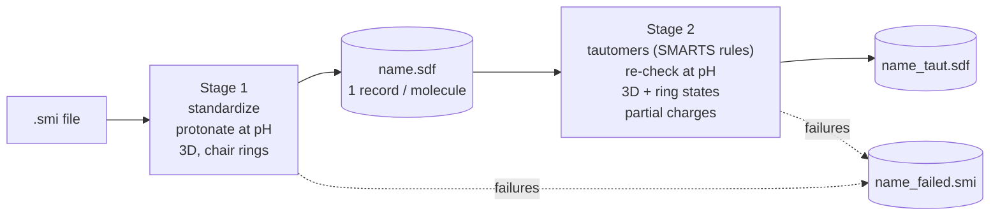

# ligprep

Ligand preparation pipeline: **SMILES → protonated 3D structures → pH-dependent low-energy tautomers**, written as SDF files with full provenance in the SD tags. Built on [RDKit](https://www.rdkit.org/) and [Dimorphite-DL](https://github.com/durrantlab/dimorphite_dl), with optional partial charges, and designed to feed docking tools such as [Meeko](https://github.com/forlilab/Meeko).

Current version: **1.3.0** (see [CHANGELOG.md](CHANGELOG.md)).



## Features

- **Standardization**: keeps the largest fragment (salts and counter-ions removed), normalizes functional groups, removes duplicate fragments.
- **Protonation**: top-ranked state at your pH (or pH range) from Dimorphite-DL.
- **Tautomers**: RDKit's SMARTS-rule enumerator, made pH-dependent, filtered to the low-energy forms by SMARTS stability rules, with the RDKit canonical tautomer flagged.
- **Ring conformers**: saturated six-membered rings are forced into chairs, and equally stable ring-flip states (for example both chairs of *cis*-1,2-dimethylcyclohexane) are written as separate records.
- **Force fields**: UFF, MMFF94 or MMFF94s (your choice), with an automatic, reported fallback to UFF when MMFF cannot parametrize a molecule.
- **Partial charges**: Gasteiger, Espaloma or none (your choice), stored in the convention that Meeko can read back.
- **Failure reporting**: molecules that cannot be prepared are written to a `.smi` file with the stage and reason, and the file can be fed straight back in.
- **Provenance**: UUID, date, software versions, original and canonical SMILES, pH and force field in every record.
- **Parallel**: multiprocessing over all cores, streaming input so memory stays low on large libraries.

## Installation

Requires **Python 3.10 or newer** (a Dimorphite-DL 2.x requirement).

```bash
git clone <your-repository-url>
cd ligprep
python -m venv .venv && source .venv/bin/activate     # or use conda
pip install -r requirements.txt
python -m pytest test_pipeline.py -q                  # optional: run the tests
```

> **Use Dimorphite-DL 2.1.0 or newer.** Versions 2.0.x leave aliphatic amines neutral at pH 7.4 and ionize phenols and imidazole/triazole N-H, so protonation states are wrong. `requirements.txt` enforces `>=2.1.0`, and the program logs a warning at startup if an older version is installed.

Tested with RDKit 2025.09.5 and 2026.09.1, and Dimorphite-DL 2.0.2 and 2.1.0.

### Optional: Espaloma charges

Only needed for `--charge_model espaloma`:

```bash
pip install espaloma_charge dgl torch
```

The model (a one-time download) is stored in `~/.cache/ligprep/espaloma_model.pt`. Set `LIGPREP_ESPALOMA_MODEL` to use a file from another location. If the packages are missing the program stops at startup with install instructions. *Espaloma support has been tested up to its availability check and its interface with the rest of the pipeline, but not run end to end with the real model.*

## Quick start

```bash
python run_ligprep.py example_input.smi demo -o results --ph 7.4 -ff MMFF94 --charge_model gasteiger
```

This writes to `results/`:

| File | Content |
|---|---|
| `demo.sdf` | Stage 1: one protonated 3D record per input molecule |
| `demo_taut.sdf` | Stage 2: low-energy tautomers (and ring states) with explicit hydrogens |
| `demo_<DDMONYY>.log` | Run log, for example `demo_16NOV26.log` |
| `demo_failed.smi` | Molecules that failed, **only created if there were failures** |

With Dimorphite-DL 2.1.0 or newer the bundled example gives 35 records in `demo.sdf` and 41 in `demo_taut.sdf`, with no failures.

## Usage

```
python run_ligprep.py [options] input_smi output_basename
```

| Option | Default | Description |
|---|---|---|
| `--ph` | 7.4 | pH for protonation |
| `--min_ph`, `--max_ph` | none | Protonate over a pH range instead of a single value |
| `-ff` | `MMFF94` | Force field: `UFF`, `MMFF94` or `MMFF94s` (case-insensitive). Falls back to UFF per molecule if MMFF lacks parameters. |
| `--charge_model` | `none` | `gasteiger`, `espaloma` or `none`. Written to the tautomer SDF only. |
| `--num-cpus` | all cores | Worker processes |
| `-o` | `.` | Output directory (created if missing) |
| `--overwrite` | off | Replace existing output SDFs (otherwise the run stops) |
| `-l` | `<output_dir>/<basename>_<DDMONYY>.log` | Log file path |
| `-v` | off | Verbose (debug) logging |
| `--max_protonation_states` | 1 | Maximum states requested from Dimorphite-DL; only the top-ranked state is used |
| `--batch_size` | 1000 | Chunk size for the multiprocessing pools |
| `--version` | | Print the version |

### Input format

A text file with one molecule per line: `SMILES`, then optionally a name, separated by a tab, comma or space. Lines starting with `#` and blank lines are ignored. Extra columns are ignored, so the failed-molecule file can be used as input. A line without a name is called `mol_<line number>`.

```
# SMILES <TAB> name
CC(=O)Nc1ccccc1	Acetanilide
C[C@H](N)C(=O)O	L-Alanine
C1CCNCC1
```

## Output records

The first line of every SDF record (the title) is the compound name in `name.sdf` and the tautomer name in `name_taut.sdf`.

Tautomer records are named `<name>_taut0001`, `<name>_taut0002`, and so on, most stable first. A tautomer that has several ring states gets a `_ring1`, `_ring2` suffix.

### SD tags

| Tag | In | Meaning |
|---|---|---|
| `Compound_Name`, `Original_SMILES`, `Canonical_SMILES` | both | Input name and SMILES, and the standardized canonical SMILES |
| `Generation_Date`, `Preparation_Software`, `RDKit_version`, `Dimorphite-DL_version` | both | Provenance |
| `pH`, `Force_field`, `UUID` | both | pH used, force field used in stage 1, unique id of the molecule (shared by all its tautomer records) |
| `Processing_Step` | both | What produced the record |
| `Tautomer_Name`, `Tautomer_Number`, `Tautomer_SMILES`, `Parent_compound` | tautomer | Record naming and tautomer identity |
| `Is_Canonical_Tautomer` | tautomer | `1` if this is RDKit's canonical tautomer, otherwise `0` |
| `Energy`, `Energy_Unit`, `Optimization_ForceField` | tautomer | Force-field energy (kcal/mol) and the force field actually used |
| `Ring_Conformer` | tautomer | `NA` (no saturated six-membered ring), `chair`, `mixed` or `non-chair` |
| `Ring_State_Number`, `Ring_State_Relative_Energy` | tautomer | Ring-state index, and energy relative to the lowest ring state of the **same** tautomer |
| `Charge_Model` | tautomer | `gasteiger`, `espaloma` or `none` |
| `atom.dprop.PartialCharge` | tautomer | Per-atom charges (only if a charge model was chosen) |

> Force-field energies are only comparable between ring states of the same tautomer. Do not use `Energy` to rank different tautomers against each other; force fields give each bonding pattern its own reference energies.

### Failed molecules

`<basename>_failed.smi` has one line per failure:

```
# ligprep v1.3.0: molecules that could not be prepared
this_is_not_a_smiles	Broken_example	stage1: standardization failed (invalid or empty SMILES)
C[Se]C	Dimethylselenide	stage2: partial-charge assignment (gasteiger) failed for every state
```

## How it works

### Stage 1: protonated 3D

1. Parse and standardize the SMILES (salts removed, functional groups normalized).
2. Protonate with Dimorphite-DL at the requested pH, keeping the top-ranked state.
3. Generate 3D with ETKDGv3, minimize with the chosen force field, and keep the lowest-energy chair arrangement.

### Stage 2: tautomers

1. **Enumerate** with RDKit's `TautomerEnumerator`, whose transformations are SMARTS rules. Stereochemistry is preserved, and tautomers that would lose a stereocentre are discarded (embedding them would assign a random configuration).
2. **pH-dependent**: every tautomer is checked against Dimorphite-DL at the same pH. A tautomer that would be ionized differently (its net charge would change) is not a microstate of the species that dominates at that pH and is dropped.
3. **Low-energy selection** with SMARTS stability rules rather than force-field energies (see the note below). Tautomers are ranked by these rules in order, and every tautomer with the best score is kept:

   | Priority | Prefer | SMARTS |
   |---|---|---|
   | 1 | more carbonyls on N or O (amide, imide, urea, ester, lactone, acid) | `[OX1,SX1]=[#6X3][#7X3,#7X2-,#8X2]` |
   | 2 | more aromatic atoms | `[a]` |
   | 3 | fewer enols | `[#6X3]=[#6X3][OX2H1]` |
   | 4 | fewer imidic acids | `[#6X3](=[NX2])[OX2H1]` |
   | 5 | fewer enamines (vinylogous amides excepted) | see `tautomer.py` |
   | 6 | fewer exocyclic ring imines | `[NX2;+0;!a]=[c]` |

   Carbonyls on N or O rank above aromaticity on purpose. Otherwise imides, hydantoins, thiazolidinediones and barbiturates become aromatic hydroxy-azoles that do not exist in practice.
4. **Canonical flag**: RDKit's canonical tautomer is flagged `Is_Canonical_Tautomer=1` whenever it is among the survivors. To always write it, even when the rules judge it high in energy, set `ALWAYS_KEEP_CANONICAL = True` in `tautomer.py`.
5. **3D** for every surviving tautomer, with explicit hydrogens, then partial charges.

> **Why not force-field energies?** Force fields cannot rank constitutional isomers. MMFF94 scored the imidic-acid enol of acetanilide 23 kcal/mol *below* the amide.

A custom SMARTS tautomer rule file can be passed to `tautomer.enumerate_tautomers(..., transforms_file=...)` from Python (RDKit's rule-file format). It is not exposed on the command line.

### Ring conformers

Embedding plus minimization returns boat or twist-boat conformers for saturated six-membered rings (cyclohexane, piperidine, morpholine ...) roughly half of the time, in minima 5-7 kcal/mol above the chair, and docking engines keep ring geometry rigid. For each molecule with such a ring:

1. an ensemble of conformers is generated and minimized (12 for one ring, 20 per ring for coupled rings, at most 60);
2. each ring is classified as chair or not from its endocyclic torsions;
3. only conformers in which every chair-capable ring is a chair are kept (rings forced out of a chair by a cage, such as bicyclo[2.2.2]octane, are left alone);
4. conformers are clustered into distinct ring states with a symmetry-aware RMSD, so symmetry-equivalent chairs are not reported twice;
5. mirror-image partners are generated exactly. In meso and achiral molecules the second chair is the exact mirror image of the first, and random sampling misses it surprisingly often;
6. the lowest-energy state plus any other within 0.5 kcal/mol are written (at most 4).

Examples: *cis*-1,2-dimethylcyclohexane gives two records (both chairs); *trans*-1,2 gives one (the diequatorial chair); *cis*-decalin gives two; *trans*-decalin, which is rigid, gives one.

### Partial charges

Charges are rounded to 3 decimals and adjusted so they sum exactly to the formal charge. They are stored the way molscrub does it, as the molecule property `atom.dprop.PartialCharge`, which RDKit turns into the atom property `PartialCharge` when it reads the SDF. Meeko reads them back with `--charge_model read`. Gasteiger has no parameters for some elements (for example Se), and such molecules are reported in the failed file.

## Using the output with Meeko

```bash
mk_prepare_ligand.py -i results/demo_taut.sdf --charge_model read --multimol_outdir pdbqt/
```

`demo_taut.sdf` has explicit hydrogens and 3D coordinates, which Meeko requires. With Meeko 0.8.0 every record of the bundled example converted without errors.

## Tunable constants

These are module constants, not command-line options.

| Constant | Default | File | Meaning |
|---|---|---|---|
| `ALWAYS_KEEP_CANONICAL` | `False` | `tautomer.py` | Always write the RDKit canonical tautomer |
| `MAX_TAUTOMERS_ENUMERATED` | 200 | `tautomer.py` | RDKit enumeration cap |
| `MAX_TAUTOMER_CANDIDATES` | 50 | `tautomer.py` | Best RDKit-scored tautomers examined further |
| `STABILITY_RULES` | see above | `tautomer.py` | SMARTS stability rules (editable list) |
| `RING_ENERGY_WINDOW` | 0.5 kcal/mol | `conformers.py` | Ring states kept relative to the lowest |
| `MAX_RING_STATES` | 4 | `conformers.py` | Maximum ring states per structure |
| `CONFS_SINGLE_RING`, `CONFS_PER_RING_MULTI`, `MAX_ENSEMBLE_CONFS` | 12, 20, 60 | `conformers.py` | Ensemble size |
| `CHAIR_MIN_TORSION` | 35° | `conformers.py` | Torsion threshold for a chair |
| `EMBED_SEED` | 42 | `conformers.py` | Embedding seed (results are reproducible) |
| `MAX_FF_ITERATIONS` | 2000 | `optimizer.py` | Minimization iteration limit |

## Performance

Measured on one CPU core with a deliberately ring-heavy test set: about 140 ms per molecule for both stages together. Ring-free molecules are much cheaper. Throughput scales with `--num-cpus`. I have not benchmarked a library of several hundred thousand molecules. On WSL, write output to the Linux filesystem (for example `~/results`) rather than `/mnt/c/...`, which is much slower.

## Known limitations

- **Only the top-ranked protonation state** is used. Dimorphite-DL's rules are heuristic, and both 2.0.x and 2.1.x over-ionize some heterocycles (2-pyridone and uracil, for example), and 2.1.x protonates the nitrogen of enaminones.
- **Tautomer selection is rule-based**, not quantum-chemical. Unusual tautomerism may be ranked wrongly. Use `STABILITY_RULES` and `ALWAYS_KEEP_CANONICAL` to adjust it.
- **Ring handling covers saturated six-membered rings only** (not 5- or 7-membered rings or macrocycles). The state enumeration is sampling-based. On a deliberately hard set of coupled, flexible rings the state count was correct in 92% of trials; every single-ring molecule in my test set was correct for all random seeds.
- **One conformer per state.** This is a preparation tool, not a conformer-ensemble generator.
- **Undefined stereocentres** are not enumerated; a configuration is chosen arbitrarily at embedding. Specify stereochemistry in the input if it matters.
- **Espaloma** has not been run end to end with the real model (see Installation).

## Project layout

| File | Role |
|---|---|
| `run_ligprep.py` | Command line and the two-stage pipeline |
| `reader.py` | Streaming `.smi` and SDF readers |
| `standardize.py` | Salt removal and normalization |
| `protonate.py` | Dimorphite-DL protonation and version check |
| `tautomer.py` | Enumeration, pH adjustment, SMARTS low-energy selection |
| `conformers.py` | 3D generation, chair detection, ring-state enumeration |
| `optimizer.py` | UFF / MMFF94 / MMFF94s minimization |
| `charges.py` | Gasteiger / Espaloma charges |
| `metadata.py`, `writer.py` | SD tags, SDF and failed-molecule writers |
| `utils.py` | Logging, UUIDs, memory tracking |
| `test_pipeline.py` | Test suite (66 tests) |
| `example_input.smi` | Demonstration input |

## Related tools

[molscrub](https://pypi.org/project/molscrub/) (also published as Scrubber) is a closely related, independently developed ligand-preparation tool from the same group as Meeko, and [Meeko](https://github.com/forlilab/Meeko) prepares ligands for AutoDock and Vina. No code from either was used here. The `PartialCharge` storage convention is compatible with both.

## License

*Add your license here.*
